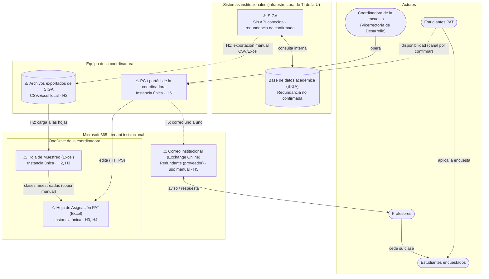

# 📄 Informe Técnico del Taller

## 🔖 Nombre del Taller
**Taller 4 - Mapa de Infraestructura y Diagnóstico Técnico (AS-IS)**

## 👥 Integrantes del equipo
- Julián David Aguilar
- Juan Esteban Ramírez

---

## 🧠 1. Descripción general del trabajo

El objetivo del taller es modelar y diagnosticar la **infraestructura tecnológica actual (AS-IS)** sobre la que opera el proceso de logística de la encuesta anual de autosatisfacción de la Universidad de La Sabana, gestionado por la Vicerrectoría de Desarrollo (Coordinación de Experiencia y Servicio).

Este taller documenta el estado real de hoy, no la solución propuesta. El mapa muestra dónde residen los datos, qué componentes procesan la información, cómo viajan los datos entre sistemas, qué redundancia tiene cada punto y dónde están los cuellos de botella y los puntos únicos de falla (SPOF).

El mapa parte del C2 del Taller 3: los dos contenedores (Hoja de Muestreo y Hoja de Asignación PAT) y los dos sistemas externos (SIGA y correo institucional) aparecen aquí con el mismo nombre, ubicados en la capa donde viven. Este diagnóstico es el insumo directo de:
1. El modelado de amenazas con STRIDE (Taller 5): cada hallazgo H1 a H6 origina al menos una amenaza.
2. La verificación de cumplimiento normativo bajo la Ley 1581 de 2012 (Taller 6).
3. La arquitectura objetivo (TO-BE, Taller 7).

---

## 🔧 2. Proceso de desarrollo

Se aplicó la metodología de 5 pasos de la guía del curso:

1. **Identificación de componentes reales:** a partir de la información de la cliente, la ficha de caracterización (Taller 0), el BPMN (Taller 1) y el C2 (Taller 3) se identificaron los activos tecnológicos reales: SIGA y su base de datos, las dos hojas de Excel en OneDrive, el correo institucional (Exchange Online), el equipo de cómputo de la coordinadora y los archivos que se descargan de SIGA a ese equipo.
2. **Agrupación por capa y ubicación:** en lugar de agrupar por roles (error de la primera versión, que se parecía más a un BPMN), los componentes se clasificaron según dónde residen y se ejecutan:
   - **Sistemas institucionales (infraestructura de TI de la U):** SIGA y su base de datos académica, administrados por la Dirección de TI. No se confirmó si están on-premise o en una nube contratada por la U.
   - **Microsoft 365 (tenant institucional, SaaS):** OneDrive de la coordinadora, donde viven las dos hojas, y Exchange Online.
   - **Equipo de la coordinadora (estación de trabajo local):** el PC/portátil donde se descargan las exportaciones de SIGA, se edita Excel y se escriben los correos.
   - **Actores:** fuera de las capas (coordinadora, estudiantes PAT, profesores y estudiantes encuestados).
3. **Mapeo de conexiones:** se distinguen las conexiones digitales (línea continua: HTTPS, SMTP) de los intercambios manuales (línea punteada: exportación de archivos, correo escrito a mano).
4. **Redundancia:** junto a cada componente crítico se indica si tiene redundancia o si es instancia única. Lo que no se pudo verificar se marca como "no confirmado".
5. **Diagnóstico priorizado:** cada hallazgo se clasificó por categoría y prioridad (sección 3.2).

---

## 🧩 3. Análisis del modelo propuesto

### 3.1. Estructura del mapa por capas

1. **Sistemas institucionales (infraestructura de TI de la U):**
   - **SIGA (sistema académico institucional):** fuente única de horarios, asignaturas, matrícula, salones y datos personales de profesores y estudiantes. No tiene una API de integración conocida para otras dependencias. Redundancia: **no confirmada** (la administra TI).
   - **Base de datos académica (SIGA):** almacén de SIGA. La Vicerrectoría no tiene acceso directo; la información solo sale por consulta web y exportación manual a CSV/Excel. Redundancia: **no confirmada**.

2. **Microsoft 365 (tenant institucional):**
   - **OneDrive de la coordinadora (cuenta institucional):** guarda las dos hojas del proceso. OneDrive como servicio tiene la redundancia del proveedor, pero cada archivo es una **instancia única** sin respaldo independiente:
     - *Hoja de Muestreo (Excel en OneDrive):* muestra por programa y semestre, con copias de datos personales exportados de SIGA.
     - *Hoja de Asignación PAT (Excel en OneDrive):* cruce manual de las clases muestreadas con la disponibilidad de los estudiantes PAT.
   - **Correo institucional (Exchange Online):** servicio redundante del proveedor. El cuello de botella no es la plataforma sino el uso: los avisos se escriben a mano, uno a uno, y las respuestas de los profesores quedan dispersas en el buzón de la coordinadora.

3. **Equipo de la coordinadora (estación de trabajo local):**
   - **PC / portátil de la coordinadora:** navegador, Excel y Outlook. Es una **instancia única**; ahí convergen la descarga de SIGA, la edición de las hojas y el envío de correos.
   - **Archivos exportados de SIGA (CSV/Excel en carpeta local):** copias descargadas antes de pasarlas a las hojas. **Instancia única**; no se confirmó si el disco está cifrado ni si los archivos se borran al terminar la encuesta.

4. **Actores (fuera de la infraestructura):**
   - **Coordinadora de la encuesta (Vicerrectoría de Desarrollo):** opera el equipo, exporta de SIGA, arma la muestra, asigna PAT y escribe los correos. Es la única persona que opera el proceso.
   - **Estudiantes PAT:** reportan su disponibilidad horaria y aplican la encuesta en el salón. No diseñan la muestra ni responden la encuesta. Esta definición es la misma del C1 (Taller 3).
   - **Profesores:** reciben el aviso por correo y responden si ceden o no su clase.
   - **Estudiantes encuestados:** la muestra por programa y semestre; responden la encuesta en el salón.

### 3.2. Diagnóstico técnico de riesgos (hallazgos H1 a H6)

> **Criterio de priorización:** **Alta** para los riesgos que pueden detener por completo el proceso (punto único de falla) o que exponen datos personales protegidos por la Ley 1581 de 2012. **Media** para los cuellos de botella que alargan los tiempos, inducen errores o impiden crecer, pero no detienen el proceso. **Baja** para ineficiencias tolerables en el corto plazo (ninguno de los hallazgos actuales).
>
> **Categorías:** Disponibilidad, Rendimiento y Escalabilidad, como pide la guía. H2 no es un riesgo de disponibilidad sino de confidencialidad, por eso se clasifica como **Seguridad de la información** y se analiza a fondo en el Taller 5 (amenazas T1, T3 y T7).

| # | Componente | Riesgo diagnosticado | Categoría | Impacto si ocurre | Prioridad |
|---|---|---|---|---|:---:|
| **H6** | Coordinadora de la encuesta / PC de la coordinadora | Todo el proceso depende de una sola persona y un solo equipo (punto único de falla operativo). | Disponibilidad | Si la coordinadora se ausenta en el periodo de la encuesta, o su equipo o cuenta fallan, nadie más puede operar el proceso: no hay respaldo, documentación ni acceso compartido. | **Alta** |
| **H3** | Hoja de Muestreo y Hoja de Asignación PAT (Excel en OneDrive) | Instancia única de cada hoja, sin respaldo independiente ni control formal de versiones. | Disponibilidad | Pérdida, corrupción o sobrescritura de la muestra o de la asignación; no se puede reconstruir ni auditar cómo se armó la muestra sin repetir semanas de trabajo. | **Alta** |
| **H2** | Archivos exportados de SIGA, Hoja de Muestreo y Hoja de Asignación PAT | Copias de datos personales (nombres, correos, horarios) fuera de SIGA, sin control de acceso por rol ni registro de quién las consulta. | Seguridad de la información | Exposición de datos personales de estudiantes y profesores; incumplimiento de la Ley 1581 de 2012 y de la política de datos de la universidad. | **Alta** |
| **H4** | Hoja de Asignación PAT (Excel en OneDrive) | Cruce manual de horarios, sin validación. | Rendimiento | Errores de cruce entre clases y disponibilidad PAT; días de trabajo para consolidar la programación y reprocesos cada vez que un profesor rechaza. | **Media** |
| **H5** | Correo institucional (Exchange Online) | Avisos escritos a mano, uno a uno, sin registro estructurado de las respuestas. | Rendimiento | Profesores sin avisar, respuestas perdidas en el buzón, asignaciones duplicadas y demoras para cerrar la programación. | **Media** |
| **H1** | SIGA | Fuente única sin API de integración conocida; los datos salen por exportación manual. | Escalabilidad | Los datos quedan desactualizados apenas se descargan (retiros, cambios de horario). El proceso no puede crecer a más programas ni automatizarse sin un acuerdo con TI. | **Media** |

### 3.3. Supuestos del análisis

- **Confirmados con la cliente:**
  - La coordinadora tiene permisos en SIGA para consultar y exportar listas de estudiantes, horarios y profesores en CSV/Excel.
  - Las hojas de cálculo están en OneDrive, asociado a la cuenta institucional de la coordinadora.
  - Los avisos se envían desde Exchange Online / Outlook con dominio `@unisabana.edu.co`.
  - La dependencia responsable es la Vicerrectoría de Desarrollo (Coordinación de Experiencia y Servicio).
- **No confirmados (pendientes para el tercer corte; preguntas en [`06-normatividad/preguntas-cliente.md`](../06-normatividad/preguntas-cliente.md)):**
  - Con quién se comparten las hojas y con qué tipo de enlace (P2).
  - Si SIGA y su base de datos tienen redundancia, y si están on-premise o en una nube contratada por la U (pregunta para TI).
  - Si SIGA tiene servicios web que TI pueda habilitar para uso administrativo.
  - Si los archivos exportados se borran del equipo al terminar la encuesta (P4).
  - Por qué canal reporta el PAT su disponibilidad (P7).

### 3.4. Trazabilidad con el C2 (Taller 3)

| Elemento del C2 | Tipo en el C2 | Dónde está en el mapa |
|---|---|---|
| Hoja de Muestreo | Contenedor | Microsoft 365 → OneDrive de la coordinadora |
| Hoja de Asignación PAT | Contenedor | Microsoft 365 → OneDrive de la coordinadora |
| SIGA | Sistema externo | Sistemas institucionales |
| Correo institucional (Exchange Online) | Sistema externo | Microsoft 365 |

El mapa agrega tres elementos de infraestructura que no son contenedores C4: la base de datos académica (interna a SIGA), el PC de la coordinadora y los archivos exportados que se guardan en él.

---

## 📈 4. Diagrama final entregado

- Archivo editable: [`mapa-final.drawio`](mapa-final.drawio). Se abre con [draw.io / diagrams.net](https://app.diagrams.net/) (File → Open From → Device).

### Representación esquemática del mapa AS-IS

---

## 📋 5. Tabla de actores, entidades o componentes

| Nombre del elemento | Tipo | Ubicación / capa | Redundancia | Descripción | Responsable |
|---|---|---|---|---|---|
| SIGA | Sistema institucional | Sistemas institucionales | No confirmada | Fuente de programas, horarios, salones, matrícula y datos personales. Sin API conocida. *(H1)* | Dirección de TI |
| Base de datos académica (SIGA) | Base de datos | Sistemas institucionales | No confirmada | Almacén de SIGA; sin acceso directo para la Vicerrectoría. | Dirección de TI |
| Hoja de Muestreo | Contenedor de datos (Excel) | Microsoft 365 → OneDrive | Instancia única | Muestra de estudiantes por programa y semestre; contiene datos personales copiados de SIGA. *(H2, H3)* | Coordinadora de la encuesta |
| Hoja de Asignación PAT | Contenedor de datos (Excel) | Microsoft 365 → OneDrive | Instancia única | Cruce manual de clases muestreadas con la disponibilidad de los PAT. *(H3, H4)* | Coordinadora de la encuesta |
| Correo institucional (Exchange Online) | Servicio SaaS | Microsoft 365 | Redundante (proveedor) | Envío manual de avisos y recepción de respuestas de profesores. *(H5)* | Dirección de TI (tenant) / Coordinadora |
| PC / portátil de la coordinadora | Estación de trabajo | Equipo de la coordinadora | Instancia única | Equipo donde se descargan los datos, se editan las hojas y se escriben los correos. *(H6)* | Coordinadora de la encuesta |
| Archivos exportados de SIGA | Archivos locales (CSV/Excel) | Equipo de la coordinadora | Instancia única | Copias descargadas de SIGA antes de pasarlas a las hojas. *(H2)* | Coordinadora de la encuesta |
| Coordinadora de la encuesta | Actor | Fuera de la infraestructura | Operadora única | Opera todo el proceso. *(H6)* | Vicerrectoría de Desarrollo (Johanna Molina) |
| Estudiantes PAT | Actor | Fuera de la infraestructura | Varios | Reportan su disponibilidad y aplican la encuesta en el salón. | Estudiantes PAT |
| Profesores | Actor | Fuera de la infraestructura | Varios | Reciben el aviso y aceptan o rechazan ceder su clase. | Facultades |
| Estudiantes encuestados | Actor | Fuera de la infraestructura | Población muestreada | Responden la encuesta en el salón. | Estudiantes |

---

## 🔍 6. Investigación complementaria

### Tema investigado:
Infraestructura de procesos administrativos universitarios basados en hojas de cálculo y correo manual (*shadow IT*), y su ruta de evolución dentro del ecosistema Microsoft 365.

### Resumen:
En las universidades es común que los procesos de apoyo dependan de un sistema académico central (en este caso SIGA) del que se extraen datos por exportación, y de hojas de cálculo que funcionan como base de datos informal del proceso. Este patrón se conoce como *shadow IT* de baja escala: es rápido de montar, pero concentra riesgos en tres frentes:
1. **Puntos únicos de falla:** la pérdida del equipo o la ausencia de la operadora detiene el proceso (H6).
2. **Integridad:** las hojas no tienen integridad referencial ni validaciones, lo que produce cruces erróneos y reprocesos (H4). La literatura sobre errores en hojas de cálculo muestra que son frecuentes y difíciles de detectar (ver investigación del Taller 3).
3. **Gobierno de datos personales:** cada exportación crea una copia fuera de los controles de SIGA, contraria al principio de acceso y circulación restringida de la Ley 1581 de 2012 y de la política de la universidad (H2).

El marco Power Platform Well-Architected de Microsoft organiza la evaluación de una carga de trabajo en pilares como confiabilidad, seguridad y excelencia operativa. Este mapa AS-IS sirve como línea base para esa evaluación en el Taller 7, donde se define cómo pasar de las hojas aisladas a un almacén gobernado dentro de Microsoft 365, respetando la restricción de la cliente de usar solo herramientas autorizadas.

---

## 📚 7. Referencias

Ver [`referencias.md`](referencias.md) para el detalle de las fuentes técnicas y normativas consultadas.

---

_Este documento hace parte de la entrega del Taller 4 del curso AREM (Arquitectura Empresarial) - Universidad de La Sabana._
